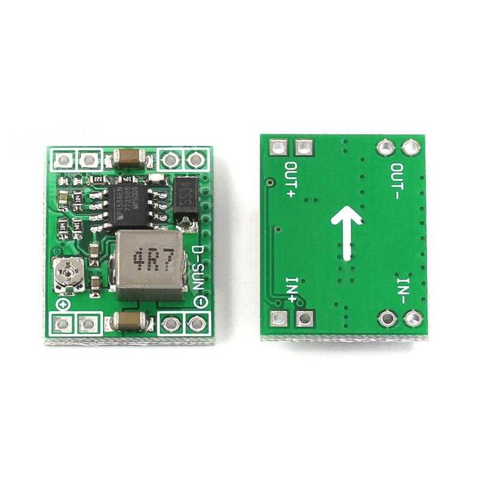

# Bộ chuyển đổi hạ áp MP1584EN

MP1584EN là bộ chuyển đổi DC-DC kiểu buck, dùng để tạo đường nguồn thấp hơn từ bộ pin 3S cho các khối điện tử. Điện áp đầu ra của module phải được chỉnh và đo xác nhận theo tải trước khi nối với STM32 hoặc cảm biến.

## Thông tin chính

* Dải điện áp đầu vào của IC: 4,5–28 V.
* Tần số chuyển mạch có thể cấu hình trong khoảng 100 kHz–1,5 MHz.
* Datasheet nêu dòng đầu ra tới 3 A trong điều kiện thiết kế phù hợp. Khả năng của module thực tế còn phụ thuộc cuộn cảm, diode, PCB, tản nhiệt và nhiệt độ; không mặc định module luôn cấp được 3 A.
* Pin Li-ion 3S có điện áp danh định 11,1 V và đạt khoảng 12,6 V khi sạc đầy.

## Vai trò trong xe

Module hạ áp cấp nguồn cho các tải điện tử theo điện áp yêu cầu của sơ đồ nguồn. Chọn điện áp đầu ra từ datasheet của tải, kiểm tra cực tính và đo điện áp trước khi kết nối. Không cấp trực tiếp điện áp pin 3S vào chân nguồn logic của STM32 hoặc BMI160.

## Tài liệu và hình ảnh

* [Datasheet MP1584EN](MP1584.PDF)
* [Tài liệu bộ nguồn buck](MP1584EN_Buck_Converter.pdf)
* 
