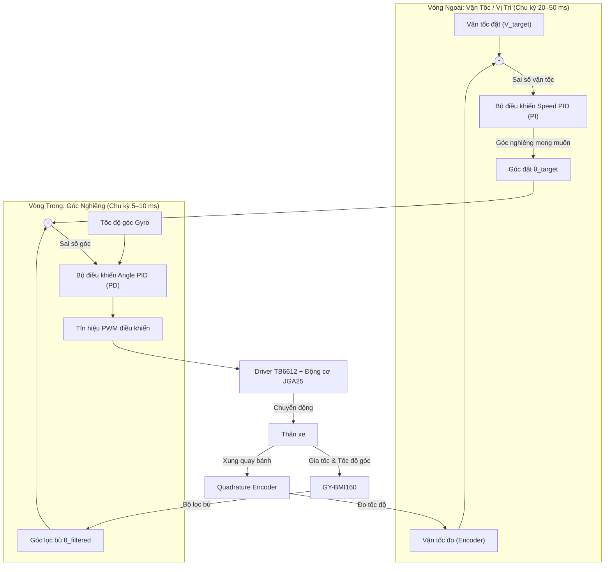
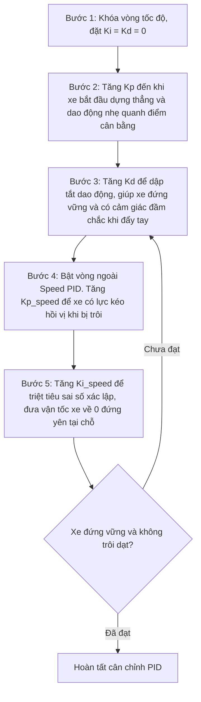

# 🎛️ Thuật Toán Điều Khiển PID Cho Xe Hai Bánh Tự Cân Bằng

Tài liệu chi tiết về cơ sở toán học, kỹ thuật rời rạc hóa, cấu trúc điều khiển lồng kép (Cascade PID) và phương pháp cân chỉnh thực nghiệm cho Robot hai bánh tự cân bằng sử dụng vi điều khiển **STM32F103C8T6**.

---

## 1. Cơ sở lý thuyết liên tục (Continuous Domain)

Bộ điều khiển **PID** (Proportional - Integral - Derivative) là thuật toán hồi tiếp vòng kín kinh điển. Tín hiệu điều khiển $u(t)$ được tính toán dựa trên sai số $e(t)$ giữa giá trị đặt (Setpoint - $r(t)$) và giá trị phản hồi đo được (Process Variable - $y(t)$):

$$e(t) = r(t) - y(t)$$

Phương trình vi phân tổng quát:

$$u(t) = K_p \, e(t) + K_i \int_{0}^{t} e(\tau) \, d\tau + K_d \, \frac{de(t)}{dt}$$

Trong đó:
* **$K_p$ (Proportional Gain):** Khâu tỷ lệ. Tác động tỷ lệ thuận với sai số hiện tại.
  * *Tác dụng:* Tăng $K_p$ giúp hệ thống phản ứng nhanh, sinh lực kéo mạnh để đưa xe về phương thẳng đứng.
  * *Hạn chế:* $K_p$ quá lớn sẽ gây vọt lố (overshoot), dao động mạnh và mất ổn định.
* **$K_i$ (Integral Gain):** Khâu tích phân. Tích lũy sai số trong quá khứ theo thời gian.
  * *Tác dụng:* Triệt tiêu sai số xác lập (steady-state error), giúp xe không bị trôi nghiêng do lệch trọng tâm.
  * *Hạn chế:* Làm chậm đáp ứng pha, dễ gây hiện tượng bão hòa tích phân (Integral Windup).
* **$K_d$ (Derivative Gain):** Khâu vi phân. Dự đoán xu hướng thay đổi sai số trong tương lai qua tốc độ biến thiên.
  * *Tác dụng:* Đóng vai trò như bộ giảm chấn ảo (damping factor), dập tắt các dao động rung lắc, giúp hệ thống ổn định và mượt mà.
  * *Hạn chế:* Rất nhạy với nhiễu đo lường tần số cao từ cảm biến.

---

## 2. Rời rạc hóa thuật toán trên Vi điều khiển (Discrete PID)

Để thực thi trên STM32 trong vòng lặp ngắt định thời với chu kỳ lấy mẫu $\Delta t$ ($T_s$):

Giả sử tại bước lặp thứ $k$:
* Sai số hiện tại: $e(k) = \text{setpoint}(k) - \text{measured}(k)$
* Khoảng thời gian lấy mẫu: $\Delta t = t_k - t_{k-1}$

### 2.1. Khâu Tỷ lệ (Proportional)
$$P(k) = K_p \cdot e(k)$$

### 2.2. Khâu Tích phân (Integral - Xấp xỉ Euler lùi)
$$I(k) = I(k-1) + K_i \cdot e(k) \cdot \Delta t$$

### 2.3. Khâu Vi phân (Derivative)
* **Vi phân sai số:**
  $$D(k) = K_d \cdot \frac{e(k) - e(k-1)}{\Delta t}$$
* **Vi phân trên giá trị đo (Derivative on Measurement):**
  Vi phân sai số có thể tạo xung kích khi setpoint thay đổi đột ngột. Có thể lấy đạo hàm âm của giá trị đo:
  $$D(k) = -K_d \cdot \frac{y(k) - y(k-1)}{\Delta t}$$
  Hàm `PID_Compute` bên dưới dùng cách này. Với vòng cân bằng góc, có thể dùng trực tiếp tốc độ gyro đã hiệu chuẩn, cùng trục, dấu và đơn vị với góc:
  $$D(k) = -K_d \cdot \omega_{gyro}(k)$$
  *Cách làm này tránh lấy sai phân số của góc đo; dữ liệu gyro vẫn cần được hiệu chuẩn và lọc nhiễu phù hợp.*

### 2.4. Tín hiệu đầu ra tổng
$$u(k) = P(k) + I(k) + D(k)$$

---

## 3. Các kỹ thuật tối ưu bắt buộc trong thực tế

### 3.1. Giới hạn tích phân và chống windup
Kẹp tích phân giới hạn mức tích lũy nhưng tự nó chưa tính đến bão hòa đầu ra. Ví dụ dưới đây minh họa phép kẹp; hàm `PID_Compute` dùng thêm tích phân có điều kiện để không tiếp tục tích lũy theo hướng đẩy đầu ra sâu hơn vào vùng bão hòa.

```c
// Giới hạn giá trị tích phân (Integrator Clamping)
if (pid->integral > pid->integral_max) {
    pid->integral = pid->integral_max;
} else if (pid->integral < -pid->integral_max) {
    pid->integral = -pid->integral_max;
}
```

### 3.2. Giới hạn tín hiệu điều khiển (Output Clamping)
Tín hiệu điều khiển phải được giới hạn tương ứng với dải giá trị PWM phần cứng hỗ trợ (ví dụ timer STM32 từ `-1000` đến `+1000`):

```c
if (output > pid->out_max) output = pid->out_max;
else if (output < pid->out_min) output = pid->out_min;
```

---

## 4. Kiến trúc điều khiển lồng kép (Cascade Dual-Loop Control)

Xe hai bánh tự cân bằng là hệ thống phi tuyến, bất ổn định dạng con lắc ngược (Inverted Pendulum). Một vòng PID đơn lẻ không thể vừa giữ xe đứng thẳng vừa kiểm soát được vị trí hay vận tốc của xe. Do đó, hệ thống sử dụng **Cấu trúc điều khiển phân tầng (Cascade Loop)**:



### Chi tiết 2 vòng lặp:
1. **Vòng lặp trong (Angle Loop - Cân bằng góc):**
   * **Mục tiêu:** Giữ thân xe cân bằng thẳng đứng.
   * **Chu kỳ thực thi:** Rất nhanh ($5\text{ms} \div 10\text{ms}$, tương đương $100\text{Hz} \div 200\text{Hz}$).
   * **Thuật toán:** Thường sử dụng **PD (Proportional - Derivative)**.
   * **Lưu ý:** Không nên dùng khâu $I$ trong vòng cân bằng vì tính trễ pha của tích phân dễ làm xe rung lắc và mất cân bằng.
2. **Vòng lặp ngoài (Speed Loop - Vận tốc/Vị trí):**
   * **Mục tiêu:** Giữ xe đứng yên tại chỗ hoặc di chuyển theo lệnh điều khiển tiến/lùi, triệt tiêu vận tốc trôi.
   * **Chu kỳ thực thi:** Chậm hơn ($20\text{ms} \div 50\text{ms}$, tương đương $20\text{Hz} \div 50\text{Hz}$).
   * **Thuật toán:** Thường sử dụng **PI (Proportional - Integral)** để đưa vận tốc trung bình về 0.
   * **Đầu ra:** Xuất ra một góc nghiêng bù trừ ($\theta_{target}$). Nếu xe có xu hướng trôi về phía trước, vòng ngoài yêu cầu xe ngả về sau để hãm lại.

---

## 5. Mã nguồn C chuẩn Module hóa cho STM32

### Khai báo cấu trúc PID (`pid.h`):

```c
#ifndef PID_H
#define PID_H

#include <stdint.h>

typedef struct {
    float Kp;             // Hệ số tỉ lệ
    float Ki;             // Hệ số tích phân
    float Kd;             // Hệ số vi phân

    float integral;       // Biến tích lũy tích phân
    float integral_max;   // Giới hạn chống tràn tích phân (Anti-windup)
    
    float prev_measured;  // Giá trị đo ở bước trước
    uint8_t derivative_initialized;

    float out_min;        // Giới hạn bão hòa dưới
    float out_max;        // Giới hạn bão hòa trên
} PID_Controller_t;

void PID_Init(PID_Controller_t *pid, float kp, float ki, float kd, 
              float integral_max, float out_min, float out_max);
void PID_Reset(PID_Controller_t *pid);
float PID_Compute(PID_Controller_t *pid, float setpoint, float measured, float dt);
float PID_Angle_Compute(PID_Controller_t *pid, float angle_setpoint, 
                        float angle_measured, float gyro_rate);

#endif
```

### Cài đặt thuật toán (`pid.c`):

```c
#include "pid.h"

void PID_Init(PID_Controller_t *pid, float kp, float ki, float kd, 
              float integral_max, float out_min, float out_max) {
    if (pid == 0) return;
    pid->Kp = kp;
    pid->Ki = ki;
    pid->Kd = kd;
    pid->integral = 0.0f;
    pid->integral_max = integral_max;
    pid->prev_measured = 0.0f;
    pid->derivative_initialized = 0U;
    pid->out_min = out_min;
    pid->out_max = out_max;
}

void PID_Reset(PID_Controller_t *pid) {
    if (pid == 0) return;
    pid->integral = 0.0f;
    pid->prev_measured = 0.0f;
    pid->derivative_initialized = 0U;
}

// Hàm tính toán tổng quát (Dùng cho vòng ngoài: Speed PID)
float PID_Compute(PID_Controller_t *pid, float setpoint, float measured, float dt) {
    if (pid == 0 || dt <= 0.0f) return 0.0f;

    float error = setpoint - measured;
    float p_term = pid->Kp * error;

    // Khởi tạo mẫu đo trước để tránh xung vi phân ở lần gọi đầu tiên.
    if (pid->derivative_initialized == 0U) {
        pid->prev_measured = measured;
        pid->derivative_initialized = 1U;
    }
    float derivative = -(measured - pid->prev_measured) / dt;
    float d_term = pid->Kd * derivative;
    pid->prev_measured = measured;

    // Tích phân có giới hạn và ngừng tăng nếu nó đẩy đầu ra sâu hơn vào bão hòa.
    float integral_limit = pid->integral_max >= 0.0f
                         ? pid->integral_max : -pid->integral_max;
    float candidate_integral = pid->integral + error * dt;
    if (candidate_integral > integral_limit) candidate_integral = integral_limit;
    else if (candidate_integral < -integral_limit) candidate_integral = -integral_limit;

    float candidate_output = p_term + d_term + pid->Ki * candidate_integral;
    float integral_output_change = pid->Ki * (candidate_integral - pid->integral);
    if (!((candidate_output > pid->out_max && integral_output_change > 0.0f) ||
          (candidate_output < pid->out_min && integral_output_change < 0.0f))) {
        pid->integral = candidate_integral;
    }

    float output = p_term + d_term + pid->Ki * pid->integral;
    if (output > pid->out_max) output = pid->out_max;
    else if (output < pid->out_min) output = pid->out_min;

    return output;
}

// Hàm PD chuyên biệt cho vòng trong (Angle Loop), dùng tốc độ gyro đã hiệu chuẩn.
float PID_Angle_Compute(PID_Controller_t *pid, float angle_setpoint, 
                        float angle_measured, float gyro_rate) {
    if (pid == 0) return 0.0f;

    float error = angle_setpoint - angle_measured;

    // 1. Khâu tỉ lệ (Phản ứng theo góc nghiêng)
    float p_term = pid->Kp * error;

    // 2. Khâu vi phân từ gyro; tránh sai phân số góc nhưng vẫn cần lọc nhiễu gyro.
    float d_term = -pid->Kd * gyro_rate;

    float output = p_term + d_term;
    if (output > pid->out_max) output = pid->out_max;
    else if (output < pid->out_min) output = pid->out_min;

    return output;
}
```

---

## 6. Quy trình cân chỉnh tham số thực nghiệm (Tuning Guide)



1. **Hiệu chỉnh điểm cân bằng (Angle Setpoint Offset):**
   * Sau khi kiểm tra chiều trục, dấu góc và chiều quay động cơ, xác định setpoint gần điểm xe có thể cân bằng khi được giữ và cấp công suất. Sai lệch cơ khí giữa cảm biến, khung xe và trọng tâm có thể khiến setpoint làm việc khác $0^\circ$; không suy ra giá trị này khi xe đang tắt động cơ.
2. **Cân chỉnh vòng góc (Angle PID - Vòng trong):**
   * Đặt toàn bộ hệ số khác bằng 0.
   * Tăng $K_{p\_angle}$ dần từ nhỏ đến khi xe phản ứng dựng thẳng nhưng còn dao động quanh điểm cân bằng.
   * Tăng $K_{d\_angle}$ dần để hấp thụ dao động. Khi chỉnh đúng, nếu dùng ngón tay đẩy nhẹ vào thân xe, bạn sẽ thấy lực cản phản kháng đàn hồi và xe trở lại vị trí thẳng đứng ngay lập tức mà không bị rung giật.
3. **Cân chỉnh vòng tốc độ (Speed PID - Vòng ngoài):**
   * Sau khi vòng góc đã ổn định, kích hoạt vòng vận tốc.
   * Tăng $K_{p\_speed}$ để khi xe bắt đầu trôi về phía trước, bánh xe sẽ tăng tốc vượt lên trước để tạo góc nghiêng ngả sau hãm lại.
   * Tăng $K_{i\_speed}$ để loại bỏ hiện tượng trôi dạt cố định theo một hướng, giữ xe nằm yên trong một diện tích nhỏ.
