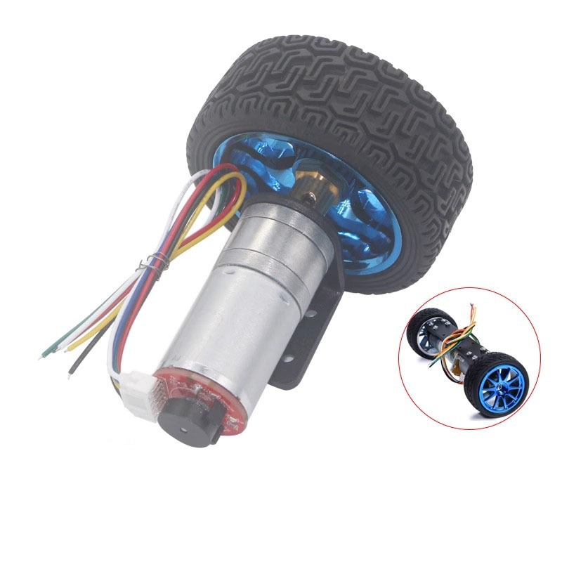

# Động cơ giảm tốc JGA25-370, 12 V, 280 rpm

Xe dùng hai động cơ DC giảm tốc có encoder hai kênh. Động cơ tạo lực kéo; encoder phản hồi chiều quay và số xung để ước lượng tốc độ bánh xe cho vòng điều khiển ngoài.

## Thông số tham khảo

* Điện áp động cơ: 12 V DC.
* Tốc độ phiên bản trong tên thư mục: khoảng 280 rpm ở trục ra hộp số.
* Tỉ số truyền được tài liệu sản phẩm ghi cho phiên bản này: khoảng 21,3:1.
* Encoder có hai kênh lệch pha A/B; tài liệu sản phẩm ghi đĩa encoder 11 xung. Cần xác nhận 11 xung được tính trên mỗi kênh và phía trục nào trước khi dùng để tính số tick mỗi vòng.
* Kích thước thân động cơ khoảng 25 mm; đường kính trục được tài liệu sản phẩm ghi là 4 mm.

Tài liệu bán hàng có thể gom nhiều phiên bản tốc độ và hộp số của cùng dòng động cơ. Hãy kiểm tra nhãn động cơ thực tế và đo số xung trục bánh xe; không dùng tỉ số truyền hoặc PPR của một phiên bản khác.

## Kết nối và sử dụng

* Cấp nguồn động cơ qua driver cầu H; không nối động cơ trực tiếp vào chân STM32.
* Cấp nguồn encoder theo tài liệu của đúng phiên bản. Kiểm tra mức logic đầu ra tương thích với STM32 trước khi đấu nối.
* Đọc đồng thời kênh A/B để xác định chiều quay. Khi dùng giải mã 4x, số đếm mỗi vòng phụ thuộc PPR được định nghĩa theo datasheet và tỉ số truyền thực tế.
* Xác nhận chiều quay hai động cơ, dấu encoder và tốc độ thực tế trước khi đóng vòng điều khiển.

## Tài liệu và hình ảnh

* [Tài liệu JGA25-370](JGA25_370_Geared_Motor.pdf)
* 

Xem thêm [cách quy đổi tick encoder](../../Control_Theory/Motor_Control.md).
