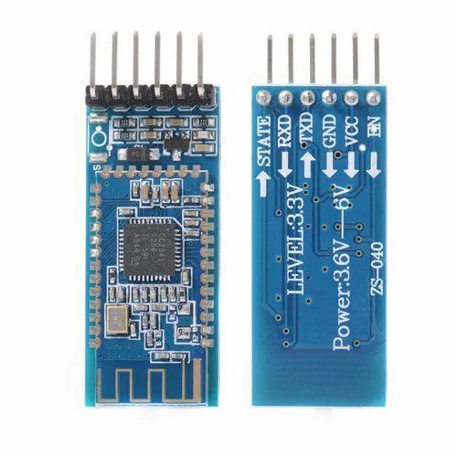

# Module Bluetooth HC-05

HC-05 tạo kênh nối tiếp không dây giữa STM32 và thiết bị điều khiển như điện thoại hoặc máy tính. Module truyền lệnh và dữ liệu trạng thái; thuật toán cân bằng vẫn chạy trên STM32.

## Vai trò và giao tiếp

* HC-05 dùng Bluetooth Classic với cấu hình nối tiếp SPP; đây không phải module Bluetooth Low Energy.
* Giao tiếp với vi điều khiển qua UART: TX của module nối tới RX của STM32, RX của module nối tới TX của STM32, và hai thiết bị phải dùng chung GND.
* Một số firmware/module hỗ trợ vai trò master hoặc slave. Vai trò, baud rate và tập lệnh AT phụ thuộc firmware và chế độ khởi động; hãy xác nhận theo tài liệu của đúng module.

## Lưu ý điện áp

Tên HC-05 được dùng cho nhiều loại breakout board. Chân VCC có thể qua bộ ổn áp trên bo, nhưng mức điện áp chân RX không nhất thiết chịu được 5 V. Kiểm tra sơ đồ và mức logic của bo cụ thể; dùng mức UART 3,3 V phù hợp với STM32F103.

## Tài liệu và hình ảnh

* [Tài liệu HC-05](HC-05.PDF)
* [Tài liệu module HC-05](HC05_Bluetooth_Module.pdf)
* 
