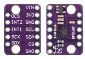

# IMU GY-BMI160

GY-BMI160 là module xoay quanh cảm biến BMI160, gồm gia tốc kế ba trục và gyro ba trục (IMU 6 trục). Trên xe cân bằng, gia tốc kế cung cấp tham chiếu trọng lực để ước lượng góc nghiêng; gyro đo tốc độ quay để điều khiển phản ứng nhanh.

## Giao tiếp và dữ liệu

* BMI160 hỗ trợ giao tiếp I²C và SPI. Dự án có thể dùng I²C nếu module và cấu hình chân trên bo cho phép.
* Địa chỉ I²C 7-bit thường là `0x68` hoặc `0x69`, tùy chân SDO/SA0. Một số API nhận địa chỉ đã dịch trái một bit; kiểm tra quy ước thư viện trước khi cấu hình.
* Dữ liệu thô cần được đổi theo dải đo gia tốc và gyro đang cấu hình. Trừ bias gyro trước khi tích phân hoặc đưa vào bộ điều khiển.
* BMI160 không có từ kế tích hợp nên không cung cấp tham chiếu yaw tuyệt đối.

## Lưu ý lắp đặt

Gắn cảm biến chắc chắn lên khung xe, ghi lại hướng các trục X/Y/Z và kiểm tra dấu bằng cách nghiêng xe thủ công. Tránh lắp gần nguồn rung mạnh hoặc dây động cơ công suất nếu có thể. Cảm biến phải dùng đúng điện áp và mức logic của module thực tế; không suy ra khả năng chịu 5 V chỉ từ tên module.

## Tài liệu và hình ảnh

* [Datasheet BMI160 của Bosch](BMI160.PDF)
* [Tài liệu module GY-BMI160](GY_BMI160_IMU_Sensor.pdf)
* 

Xem [lý thuyết IMU](../../Control_Theory/IMU_Theory.md) và [bộ lọc bù](../../Control_Theory/Complementary_Filter.md).
