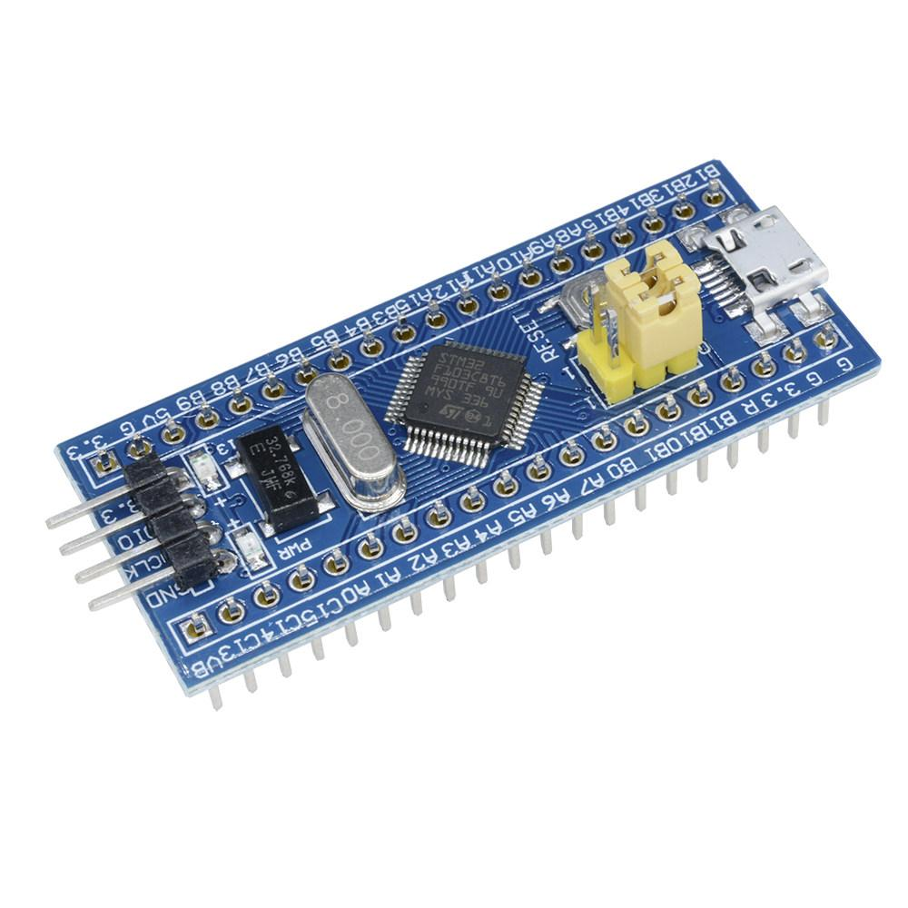

# STM32F103C8T6 Blue Pill

STM32F103C8T6 là bộ điều khiển trung tâm của xe. Vi điều khiển đọc IMU và encoder, chạy bộ lọc cùng thuật toán điều khiển, rồi xuất tín hiệu tới driver động cơ và module Bluetooth.

## Nhiệm vụ trong hệ thống

* Đọc gia tốc kế và gyro BMI160 qua I²C hoặc SPI theo cấu hình phần cứng.
* Đọc hai encoder bằng timer ở chế độ encoder hoặc bộ đếm phù hợp.
* Chạy vòng cân bằng góc và vòng điều khiển tốc độ theo chu kỳ lấy mẫu đã chọn.
* Phát PWM và tín hiệu chiều quay tới TB6612FNG.
* Trao đổi lệnh và trạng thái qua UART với HC-05.

## Tài nguyên và lưu ý

STM32F103C8T6 dùng lõi Cortex-M3, có các timer, UART, I²C và SPI cần cho kiến trúc này. Tần số lõi tối đa và dung lượng bộ nhớ phải lấy theo datasheet của đúng mã chip; một số bo Blue Pill trên thị trường có thể dùng linh kiện thay thế hoặc bản sao.

Chân I/O của MCU làm việc ở mức logic 3,3 V. Kiểm tra điện áp và pinout của đúng bo trước khi đấu dây; không mặc định mọi chân chịu được 5 V. Chưa gán chân ngoại vi trong tài liệu này vì cần đối chiếu với sơ đồ phần cứng cuối cùng.

## Tài liệu và hình ảnh

* [Datasheet STM32F103x8/xB](STM32F103X6.PDF)
* [Tài liệu bo Blue Pill](STM32F103C8T6_BluePill.pdf)
* 
