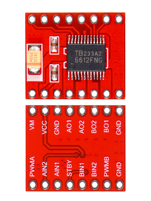

# Module driver động cơ TB6612FNG

TB6612FNG là driver cầu H kép. STM32 đưa tín hiệu PWM và chiều quay vào driver; driver đóng/ngắt dòng từ nguồn động cơ tới hai động cơ DC. STM32 không cấp dòng động cơ trực tiếp.

## Kênh và chế độ điều khiển

* Kênh A và B điều khiển hai động cơ độc lập; nối motor trái/phải theo sơ đồ mạch thực tế.
* Mỗi kênh hỗ trợ quay thuận, quay nghịch, phanh ngắn mạch và dừng thả trôi. Chân `STBY` đưa driver vào chế độ chờ.
* PWM đặt tốc độ trung bình; `IN1` và `IN2` chọn chiều. Mức `PWM = LOW` tạo phanh theo bảng trạng thái của chip.

## Nguồn và giới hạn

* Datasheet nêu dải hoạt động `VM` 2,5–13,5 V và `VCC` 2,7–5,5 V; kiểm tra thêm giới hạn của breakout board cụ thể.
* Pin 3S đạt 12,6 V khi sạc đầy, nằm trong dải `VM` nêu trên; vẫn cần xác nhận motor và module tương thích.
* Datasheet nêu dòng trung bình 1,2 A và dòng đỉnh 3,2 A cho IC theo điều kiện quy định. Dòng liên tục khả dụng phụ thuộc tản nhiệt, bo mạch và nhiệt độ. Kiểm tra dòng kẹt trục của motor trước khi chọn driver.
* Nối chung GND logic và GND công suất theo thiết kế; cấp nguồn motor vào `VM`, nguồn logic vào `VCC`.

## Tài liệu và hình ảnh

* [Datasheet Toshiba TB6612FNG](TB6612FNG.PDF)
* [Tài liệu module driver](TB6612FNG_Motor_Driver.pdf)
* 

Xem [bảng trạng thái và mã điều khiển mẫu](../../Control_Theory/Motor_Control.md).
